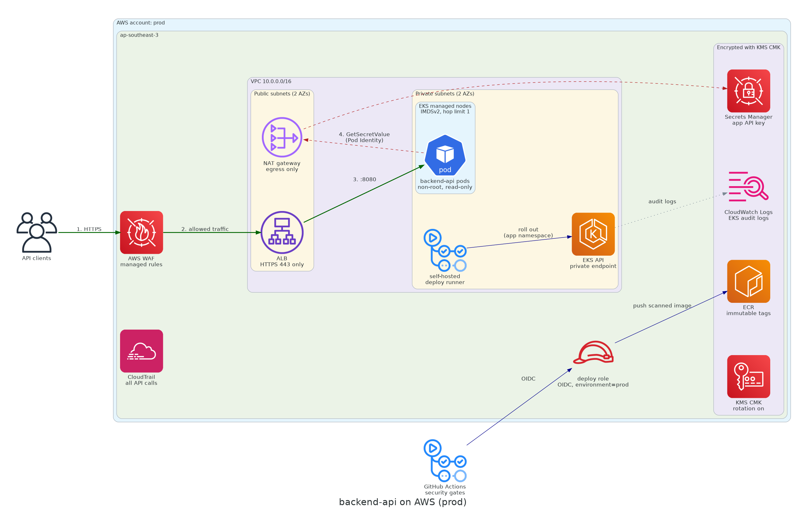

# DevSecOps Home Test

**Name:** Muhammad Irfan Junaidi\
**Date:** 7 November 2026

Secure deployment of a containerized backend API on AWS, with a CI/CD pipeline that detects vulnerabilities early and automatically blocks releases that violate security policy.

## Repository layout

| Path | Contents | Task |
|---|---|---|
| `architecture/architecture-diagram.png` | AWS architecture diagram | 1 |
| `app/` | FastAPI sample API (`src/`), unit tests (`tests/`), pinned `requirements.txt` and `requirements-dev.txt`, hardened `Dockerfile` | 2, 4 |
| `sonar-project.properties` | SonarQube analysis settings; waits for the quality gate | 2 |
| `terraform/` | Minimal AWS deployment on EKS: network, IAM, encryption, secrets | 1, 3 |
| `terraform/examples/insecure/` | Known-bad fixture the IaC gate must reject (never applied) | 3 |
| `.github/workflows/devsecops.yml` | Security pipeline: SAST, SCA, secrets, IaC, container, DAST, deploy gate | 2, 6 |
| `.github/dependabot.yml` | Weekly update PRs for the base image, Python packages, Actions and Terraform providers | 4 |
| `.trivyignore.yaml` | Approved vulnerability exceptions, each with a reason and an expiry | 4 |
| `security/zap-rules.tsv` | Which OWASP ZAP findings block a release | 6 |
| `security/vulnerability-policy.md` | Severity-based vulnerability handling | 4 |
| `security/incident-response.md` | Troubleshooting and incident response scenarios | 5 |
| `evidence/scan-results.md` | Scan output and pipeline execution evidence | 2, 3, 4, 6 |

## 1. Architecture overview



- **Implemented in [terraform/](terraform/):** the VPC, EKS, IAM, KMS, Secrets Manager, ECR and CloudWatch parts.
- **Design only:** WAF, CloudTrail, the self-hosted runner and the load balancer controller (see [§8](#8-known-limitations-and-remaining-risks)).

### Request flow

1. A client calls the API over HTTPS (TLS 1.2+, certificate from ACM).
2. AWS WAF on the ALB applies AWS managed rules (common exploits, known bad inputs, a rate limit) and drops matching requests.
3. The ALB in the public subnets terminates TLS and forwards to the pod IPs in the private subnets on port 8080. Only the ALB's security group can reach that port.
4. The app checks the `X-API-Key` header and responds. It fetched that key from Secrets Manager when it started.

The ALB itself is created by the AWS Load Balancer Controller from a Kubernetes Ingress.

### Public vs private resources

- **Public:**
  - The ALB, port 443 only, behind WAF.
  - The NAT gateway. It is outbound only, so nothing can connect in through it.
- **Private:**
  - EKS nodes and pods, which have no public IPs.
  - The EKS API endpoint (private access only).
  - The self-hosted deploy runner.
- **No network exposure:** ECR, Secrets Manager, KMS and CloudWatch Logs are reached only with IAM credentials. Today they're reached through the NAT gateway; VPC endpoints would be the next hardening step.

### Secret retrieval

1. **Terraform creates an empty secret.** It is encrypted with the KMS key, and its value is set directly in Secrets Manager, never through Terraform.
2. **The pod gets short-lived credentials.** It runs as the `backend-api` service account. EKS Pod Identity gives it credentials for the app role, which can only read that one secret and decrypt it through Secrets Manager.
3. **The app reads the key once at startup.** It calls Secrets Manager with `APP_SECRET_ID` and keeps the key in memory.

The value never appears in the image, Git, Terraform state, environment variables or a Kubernetes Secret.

### IAM roles (CI/CD pipeline vs runtime application)

| Role | Used by | Can | Cannot |
|---|---|---|---|
| `deploy` | The GitHub Actions `prod` job, via OIDC (1-hour credentials) | Push to the app's ECR repo; describe the cluster; edit the app namespace | Read secrets, change IAM or infrastructure, or touch other namespaces |
| `app` | backend-api pods, via Pod Identity | Read its one secret | Anything else |
| `eks-node` | Worker nodes | Join the cluster, pull images, run pod networking | Be used from inside pods (IMDSv2 hop limit 1) |
| `eks-cluster` | The EKS control plane | `AmazonEKSClusterPolicy` | — |

Infrastructure changes (`terraform apply`) belong to a separate, more privileged role. It's allowed only from `main` after approval, and isn't part of this minimal setup.

**Example critical control:** the deploy role's trust policy ([terraform/iam.tf](terraform/iam.tf)). Only a job running in this repo's `prod` environment, which needs a reviewer's approval, can get production deploy credentials. No other repo, branch, fork or workflow can.

```hcl
data "aws_iam_policy_document" "deploy_assume" {
  statement {
    actions = ["sts:AssumeRoleWithWebIdentity"]

    principals {
      type        = "Federated"
      identifiers = [aws_iam_openid_connect_provider.github.arn]
    }

    condition {
      test     = "StringEquals"
      variable = "token.actions.githubusercontent.com:aud"
      values   = ["sts.amazonaws.com"]
    }

    condition {
      test     = "StringEquals"
      variable = "token.actions.githubusercontent.com:sub"
      values   = ["repo:${var.github_repo}:environment:${var.environment}"]
    }
  }
}
```

### Preventing unauthorized access to production

- **Separate account:** prod runs in its own AWS account. SCPs deny creating IAM users or access keys, disabling CloudTrail, and use of unapproved regions.
- **No long-lived credentials:** the pipeline uses OIDC. People sign in through IAM Identity Center with MFA and short sessions. A break-glass admin role exists, and its use triggers an alarm.
- **One way to change prod:** a PR, then every pipeline gate, then reviewer approval on the `prod` environment.
- **Cluster access:**
  - The EKS API is private, and access is granted only through access entries.
  - The deploy role is limited to the app namespace.
- **Network:** only the ALB is public. Security groups allow only ALB → pods.
- **Audit:**
  - CloudTrail runs as an organization trail, with logs stored in a separate log-archive account. EKS audit logs go to CloudWatch.
  - Alerts fire on root sign-in, IAM changes and CloudTrail changes.

### Security risks and mitigations

| # | Risk | Mitigation |
|---|---|---|
| 1 | Stolen or over-broad CI credentials used to take over prod | OIDC credentials that last 1 hour and only work for `environment:prod`; a least-privilege deploy role; EKS access limited to one namespace; required reviewers |
| 2 | Secrets leaked through Git, images, logs or Terraform state | Secrets Manager with Pod Identity; gates for Gitleaks (Git history, redacted output) and Trivy (image layers); no secret values in Terraform |
| 3 | A vulnerable dependency or base image ships | SCA and container gates (Critical and fixable High block); distroless base image; Dependabot; weekly re-scan |
| 4 | Web attacks on the public API (injection, scanning, floods) | WAF managed rules and a rate limit; HTTPS only; API key authentication; DAST in the pipeline ([§4](#4-dast-and-owasp-top-10)) |
| 5 | A compromised pod used to move further in | The pod runs non-root, with a read-only filesystem, no shell and all capabilities dropped. IMDSv2 hop limit 1 blocks access to node credentials. The app role reads one secret only, and nodes sit in private subnets |
| 6 | Misconfigured infrastructure (public database, open security group, unencrypted data) | Checkov gate on every PR; private subnets; KMS CMK; locked default security group |
| 7 | Unauthorized or unnoticed changes in prod | Separate account and SCPs; approval gate; CloudTrail and EKS audit logs with alerts |

## 2. Prerequisites and execution instructions

**Local tools:** Docker (every scanner runs in a container), Terraform ≥ 1.11, and optionally TFLint.

No cloud account or server is needed to run the pipeline. Every stage runs on GitHub-hosted runners, SAST uses SonarQube Cloud, and the deploy stage is simulated.

**One-time setup:**

1. **Make the repository public.** On the free GitHub plan, environment reviewers and branch protection only work on public repositories. Public repos also get free Actions minutes and free SonarQube Cloud. The repo contains no secrets.
2. **SonarQube Cloud:**
   - Sign in at [sonarcloud.io](https://sonarcloud.io) with GitHub and import the repository.
   - In the project, set *Administration → Analysis Method* to CI-based analysis, and turn **off** Automatic Analysis. The two can't run together, and only CI analysis receives the coverage report.
   - Add the repository variables `SONAR_ORGANIZATION` and `SONAR_PROJECT_KEY`, copied from SonarQube Cloud.
   - Add the repository secret `SONAR_TOKEN`, created under *My Account → Security*.
3. **Create the `prod` environment** (Settings → Environments) with required reviewers. If it doesn't exist, GitHub creates it on first use *without* protection rules.
4. **Protect `main`:** require pull requests, and require these status checks to pass: `source-validation`, `terraform-validate`, `sast`, `sca`, `secret-scan`, `iac-checkov`, `container-scan`, `dast`.

**Execution:**

- The pipeline runs on every pull request, on every push to `main`, and every Monday at 02:00 UTC.
- `deploy` runs only for pushes to `main`, after a reviewer approves it.
- The local equivalents of every stage are in [§7](#7-validation-commands).

## 3. CI/CD workflow and security gates

[.github/workflows/devsecops.yml](.github/workflows/devsecops.yml) is the whole pipeline.

### Pipeline stages

| # | Stage | Job | Tool | Checks performed | Fails the pipeline when |
|---|---|---|---|---|---|
| 1 | Source validation | `source-validation`, `terraform-validate` | ruff, pytest + coverage, `terraform fmt`/`validate` | Lint, formatting, unit tests, Terraform syntax | Any lint or format error, failing test or invalid Terraform |
| 2 | SAST | `sast` | SonarQube Cloud (local evidence: Community Build 26.11) | Bugs, vulnerabilities, security hotspots, coverage and duplication in `app/src` | The quality gate fails ("Sonar way": any new issue, new-code coverage < 80%, or duplication > 3%) |
| 3 | SCA | `sca` | Trivy 0.76.2 (`fs`) | CVEs in the pinned Python dependencies, before any image is built | Any Critical; any High with a fix available (minus approved exceptions) |
| 4 | Secret scanning | `secret-scan` | Gitleaks 8.30.1 | The full Git history, not just the latest commit | Any finding |
| 5 | IaC scanning | `iac-checkov` | Checkov 3.4.3 | Misconfigurations in IAM, encryption, network exposure and logging | Any failed check that isn't skipped inline with a reason |
| 6 | Image build | `container-scan` | `docker build` | Multi-stage build; pinned dependencies installed from prebuilt wheels only | The build fails |
| 7 | Container scanning | `container-scan` | Trivy 0.76.2 (`image`) | OS and Python package CVEs; secrets in image layers | A secret is found; any Critical; any High with a fix available (minus approved exceptions) |
| – | DAST | `dast` | OWASP ZAP 2.17.0 (API scan) | Authenticated passive and active checks against the running image ([§4](#4-dast-and-owasp-top-10)) | Any of the 32 FAIL rules in [security/zap-rules.tsv](security/zap-rules.tsv) matches |
| 8 | Deployment approval | `deploy` | GitHub Environment `prod` | Runs only on `main` after every other job passes, then waits for a reviewer | Not approved, or any earlier job failed |

Stages 1–7 run in parallel, except that SAST waits for the test coverage report and DAST waits for the scanned image. `deploy` depends on all of them, so a failure anywhere blocks the release. Every scanner's report is uploaded as a workflow artifact (JSON/SARIF/JUnit) as evidence.

### Lower-severity findings

[security/vulnerability-policy.md](security/vulnerability-policy.md) sets the rules:

- **What blocks:** Critical findings, Highs with a fix available, and any secret. A Critical with no fix yet can ship only under an approved, 7-day exception when the [policy's conditions](security/vulnerability-policy.md#releasing-with-a-critical-or-high-that-has-no-fix) hold.
- **What doesn't block:** Medium and Low findings, and Highs with no fix yet. They stay visible in the uploaded reports and the SonarQube dashboard, and are tracked as issues with fix deadlines (Critical 2 days, High 7 days, Medium 30 days, Low 90 days).
- **New CVEs:** the Monday re-run catches CVEs published after a merge.

### Production deployment protection

- **When it runs:** `deploy` only runs for pushes to `main`, which means merged PRs. It never runs on PRs or scheduled runs.
- **What it depends on:** it `needs` every gate job, then waits for a required reviewer on the `prod` environment.
- **Who can get prod credentials:** the AWS deploy role trusts only the OIDC subject `repo:<owner>/<repo>:environment:prod` ([terraform/iam.tf](terraform/iam.tf)). A modified workflow can't get prod credentials outside this approved job.
- **What gets deployed:** the exact image that passed the container scan, passed along as an artifact rather than rebuilt.
- **Simulation only:** the job currently just simulates the release. A real deploy would add `id-token: write` to this job only, assume the role, push to ECR, and roll out from a runner inside the VPC, because the EKS API is private.

### Pipeline credentials

- **GitHub token:** read-only for every job (`permissions: contents: read`). Checkout doesn't persist it (`persist-credentials: false`).
- **AWS:** no AWS keys are stored in GitHub. A deploy gets 1-hour credentials through OIDC.
- **Stored secrets:** only `SONAR_TOKEN`. It's passed as an environment variable, not a command-line argument, and GitHub masks it in logs. The SonarQube organization and project key are plain repository variables, because they aren't secret.
- **Leaked secrets:** Gitleaks runs with `--redact`, so a leaked secret is never printed in the logs or the SARIF report.
- **Pinning:** third-party Actions are pinned to commit SHAs, and tool images are pinned by digest, so a hijacked tag can't change what runs.

### False positives and accepted risks

Every exception is recorded next to the code or the finding, and is reviewed:

| Tool | How to suppress | Requirement |
|---|---|---|
| Trivy (SCA, container) | Entry in [.trivyignore.yaml](.trivyignore.yaml) | A `statement` with the evidence and an `expired_at` date (see the policy); added through a reviewed PR |
| Checkov | Inline `#checkov:skip=<ID>:<rule>. Skipped because <reason>` | The reason goes in the comment; the exception is listed in [§8](#8-known-limitations-and-remaining-risks) |
| Gitleaks | Fingerprint in `.gitleaksignore`, or `gitleaks:allow` on the line | Confirmed false positives only. A real leaked secret is rotated, never ignored |
| OWASP ZAP | Set the rule to IGNORE in [security/zap-rules.tsv](security/zap-rules.tsv), with the reason after a tab | Added through a reviewed PR; turning off a FAIL rule needs security's approval |
| SonarQube | Mark the issue "False positive" or "Accept" in SonarQube, with a comment | Needs the Administer Issues permission; recorded in the issue history. `# NOSONAR` isn't used because it hides every issue on the line without a reason |

## 4. DAST and OWASP Top 10

The `dast` job runs OWASP ZAP 2.17.0 after `container-scan`, against the exact image that passed it.

### Safe test environment

- **Throwaway container:** the image runs as a container on the CI runner, on a Docker network created with `--internal`, which has no route out of the runner. It runs with `--read-only --cap-drop ALL`, like production.
- **Throwaway key:** a random API key is generated for each run and masked in the logs.
- **No cloud access:** `APP_SECRET_ID` isn't set, so the app has no AWS access, and the job has no cloud credentials at all.
- **Docs on for the test only:** the API docs are switched on here only (`APP_ENABLE_DOCS=true`), so ZAP can read the OpenAPI definition.
- **Nothing persists:** everything is destroyed when the job ends.

### Automated DAST checks

`zap-api-scan.py` imports the OpenAPI definition, calls every endpoint, then runs two kinds of checks:

- **Passive checks on every response:** missing security headers, information leaks (stack traces, server versions, PII), caching, unexpected content types.
- **Active attacks on every parameter:** SQL, OS command, template, XPath, XSLT and code injection; XSS; path traversal; remote file inclusion; XXE; CRLF; Log4Shell and Spring4Shell; cloud metadata exposure; external redirects.

On the internal network ZAP runs the 114 rules shipped in the pinned image and can't download add-ons mid-scan, so every run uses the same rule set.

The first scan flagged two missing headers. The app now sends `X-Content-Type-Options`, `Cross-Origin-Resource-Policy` and `Cache-Control: no-store` on every response.

### Authentication during testing

- **How ZAP logs in:** it adds `X-API-Key: <run key>` to every request through its `ZAP_AUTH_HEADER` / `ZAP_AUTH_HEADER_VALUE` settings. It therefore tests the real endpoints, not just the 401 response.
- **Handling the key:** it exists only inside the job, is masked, and is passed as an environment variable, never on a command line.
- **Rejecting bad keys:** the unit tests cover missing and wrong keys.

### Release-blocking findings

[security/zap-rules.tsv](security/zap-rules.tsv) sets 32 rules to FAIL:

- injection of any kind;
- XSS;
- remote code execution;
- path traversal and remote file inclusion;
- XXE;
- cloud metadata exposure;
- external redirects;
- padding oracle;
- PII disclosure.

Any of these fails `dast`, which blocks `deploy`. Everything else is WARN: it appears in the HTML/JSON report and is tracked under the [vulnerability policy](security/vulnerability-policy.md). A confirmed false positive is set to IGNORE in the same file, with a reason, through a PR.

### Protecting production from security testing

- **Only one target:** `http://app:8080` on the internal network. The job has no network route, hostname or credentials for staging or production.
- **Production is never scanned:** DAST runs before `deploy`, and the pipeline never points ZAP at production.
- **Active attacks stay contained:** they send attack payloads and can create or delete data, so they only run against a throwaway container with no real data. Any testing of shared environments would be scheduled, rate-limited and announced, and isn't part of this pipeline.
- **Authorization:** only applications and environments we own, or are explicitly authorized to test, are ever scanned.

### OWASP Top 10 risks

Categories from the [OWASP Top 10:2025](https://owasp.org/Top10/2025/).

| Risk | Detection | Mitigation |
|---|---|---|
| A01 Broken Access Control | Unit tests for missing/wrong keys (401); authenticated ZAP scan; SonarQube | API key required on every data endpoint; least-privilege IAM; EKS access limited to one namespace |
| A02 Security Misconfiguration | Checkov on Terraform; ZAP passive header checks; Trivy | Docs off in production; no `Server` header; security headers; private subnets; locked default security group; IMDSv2 |
| A03 Software Supply Chain Failures | Trivy SCA and image scan; Gitleaks; Dependabot | Pinned dependencies, base-image digest, Action SHAs and tool-image digests; distroless base image |
| A05 Injection | ZAP active injection rules (blocking); SonarQube | Typed, validated inputs (Pydantic); no SQL, shell or templates built from input |
| A07 Authentication Failures | Unit tests; authenticated ZAP scan | Key held in Secrets Manager and compared in constant time; WAF rate limit against brute force; HTTPS only |
| A10 Mishandling of Exceptional Conditions | Unit test showing startup fails without a secret | The app refuses to start without its secret; generic error responses with no stack traces |

## 5. Terraform security scenarios

<!-- Task 3 -->

### Scenario A: Overly permissive IAM

`"Action": "*", "Resource": "*"` makes the role an administrator of the whole account. Suppose anything holding the role is exposed, such as an app with an SSRF or remote-code-execution bug, or a compromised CI runner. The attacker can then do or create anything:

- create IAM users and keys to keep access;
- read every secret and bucket;
- delete resources and backups;
- stop CloudTrail to hide what they did.

The safer approach is implemented in [terraform/iam.tf](terraform/iam.tf):

- **Separate roles, each scoped to specific resources.**
  - The deploy role can push to one ECR repo and edit one Kubernetes namespace.
  - The app role can read one secret.
  - The node and cluster roles use only AWS-managed policies. IMDSv2 with hop limit 1 stops a compromised pod from taking the node's credentials.
  - The only `"*"` is `ecr:GetAuthorizationToken`, which AWS can't scope.
- **Short-lived credentials.** The pipeline assumes its role through GitHub OIDC for 1 hour, and no AWS keys are stored in GitHub. Only the matching GitHub Environment can assume the role, and `prod` requires a reviewer.
- **Cross-account.** Each environment has its own AWS account, so a dev pipeline can't reach prod. An SCP on prod is the backstop: it denies creating IAM users or keys and disabling CloudTrail.

### Scenario B: Publicly accessible database

The `iac-checkov` job scans every PR.

- A public database fails `CKV_AWS_17` (`publicly_accessible = true`), so Checkov exits non-zero.
- Branch protection on `main` then blocks the merge, so the change never reaches `terraform apply`.

That one check is enough, because RDS only gets a public IP when `publicly_accessible = true`. The [insecure example](terraform/examples/insecure/main.tf) proves it; see the [scan output](evidence/scan-results.md#iac-scanning-terraform).

The fix: keep the database in private subnets, and allow its port only from the EKS node security group. Any exception needs an inline `#checkov:skip` with a reason, reviewed in the PR.

### Scenario C: Secret exposed in Terraform state

Treat the password as compromised. `sensitive = true` hides it from CLI output, not from state.

1. **Rotate** the password and confirm the old one no longer works.
2. **Check for misuse** during the exposure window, in CloudTrail and the state bucket's access logs.
3. **Offload the secret to Secrets Manager.** Remove the variable and any `*.tfvars` that set it.
   - Terraform manages only the secret's container, encryption and access. [`aws_secretsmanager_secret.app`](terraform/main.tf) has no value.
   - The app reads the value at runtime through Pod Identity.
   - Values are changed in Secrets Manager, or rotated automatically, never in Terraform.
   - When Terraform itself needs a value, read it with an ephemeral resource and pass it to a write-only argument (Terraform ≥ 1.11). Neither is saved to state:

     ```hcl
     ephemeral "aws_secretsmanager_secret_version" "db" {
       secret_id = aws_secretsmanager_secret.db.id
     }

     resource "aws_db_instance" "app" {
       # ...
       password_wo         = ephemeral.aws_secretsmanager_secret_version.db.secret_string
       password_wo_version = 1
     }
     ```

     For RDS, `manage_master_user_password = true` is simpler: RDS generates and rotates the password itself.
4. **Clean up state.** Apply, then delete old state versions and any local or CI copies.
5. **Protect state.** Use an encrypted, versioned S3 backend with access limited to the Terraform role. `.gitignore` keeps state files and `*.tfvars` out of Git.
6. **Prevent recurrence** with Gitleaks in the pipeline and as a pre-commit hook.

## 6. Security decisions and assumptions

- **Platform:**
  - EKS with a managed AL2023 node group in private subnets.
  - Default region `ap-southeast-3` (Jakarta).
- **Private cluster API:** the EKS API endpoint is private only. GitHub-hosted runners can't reach it, so the deploy job runs on a self-hosted runner inside the VPC (or the cluster pulls changes through GitOps).
- **Encryption:**
  - One customer-managed KMS key per environment, with rotation, encrypts Kubernetes Secrets, Secrets Manager, ECR and control-plane logs.
  - Node EBS volumes use the AWS-managed EBS key.
- **App secrets:**
  - The app reads its API key from Secrets Manager through the AWS SDK at startup, using Pod Identity (`APP_SECRET_ID`). No Kubernetes Secret holds a copy.
  - `APP_API_KEY` exists for local runs only.
  - With neither set, the app refuses to start.
- **Container image:**
  - **Base:** `gcr.io/distroless/python3-debian13:nonroot`, pinned by digest. It has no shell or package manager and runs as UID 65532. Of the candidates scanned, it had 0 Critical findings; the older debian12 base had 2, and `python:3.13-slim` ships a shell and apt. Chainguard's image had 0 CVEs, but its free tier only publishes `latest` (currently Python 3.15), so the Python version couldn't be pinned.
  - **Dependencies:** `requirements.txt` pins every package with `==`, including transitive ones, so each build installs the same versions. Dependabot opens PRs to bump them.
  - **What's copied in:** `.dockerignore` is an allowlist, so only `requirements.txt` and `src/` reach the build.
  - **Hardening:**
    - The API docs (`/openapi.json`, `/docs`) are off unless `APP_ENABLE_DOCS=true`.
    - The `Server` header is removed.
    - Every response sets `X-Content-Type-Options: nosniff`, `Cross-Origin-Resource-Policy: same-origin` and `Cache-Control: no-store`.
- **Environment separation:**
  - One AWS account and one state backend per environment, selected with `-var environment=<env>` and `-backend-config`.
  - All resources carry `Project`, `Environment`, `Owner` and `ManagedBy` tags through provider `default_tags`.
- **Not applied:** the Terraform is validated and scanned but not applied, because no AWS account was used for this test.

## 7. Validation commands

```bash
# Source validation (lint, format, tests with coverage)
docker run --rm -v "$PWD:/usr/src" -w /usr/src/app -e PYTHONPATH=src python:3.13-slim-trixie sh -c \
  "pip install -q -r requirements.txt -r requirements-dev.txt && ruff check src tests && ruff format --check src tests \
   && pytest --cov=app --cov-report=term --cov-report=xml:coverage.xml tests"

# SAST against a local or self-hosted SonarQube (reads sonar-project.properties, waits for the quality gate)
docker run --rm -e SONAR_HOST_URL -e SONAR_TOKEN -v "$PWD:/usr/src" sonarsource/sonar-scanner-cli:12.3

# SCA on the pinned dependencies
docker run --rm -v "$PWD:/work" -w /work aquasec/trivy:0.76.2 fs app --scanners vuln \
  --severity CRITICAL --ignorefile .trivyignore.yaml --exit-code 1

# Secret scanning over the full Git history
docker run --rm -v "$PWD:/repo" -w /repo ghcr.io/gitleaks/gitleaks:v8.30.1 git . --redact --verbose --exit-code 1

# Terraform validation and IaC scan
terraform -chdir=terraform fmt -check -recursive
terraform -chdir=terraform init -backend=false
terraform -chdir=terraform validate
tflint --chdir=terraform
docker run --rm -v "$PWD:/src" -w /src bridgecrew/checkov:3.4.3 \
  -d terraform --skip-path examples --framework terraform --compact

# Negative test: must exit 1
docker run --rm -v "$PWD:/src" -w /src bridgecrew/checkov:3.4.3 \
  -d terraform/examples/insecure --framework terraform --compact --quiet

# Plan against a real account
terraform -chdir=terraform init -backend-config=backend/dev.s3.tfbackend
terraform -chdir=terraform plan -var environment=dev -var github_repo=<owner>/<repo>

# Container build and scan
docker build -t backend-api:local app
docker save backend-api:local -o image.tar
docker run --rm -v "$PWD:/work" -w /work aquasec/trivy:0.76.2 image --input image.tar --scanners vuln,secret
docker run --rm -v "$PWD:/work" -w /work aquasec/trivy:0.76.2 image --input image.tar \
  --scanners vuln --severity CRITICAL --ignorefile .trivyignore.yaml --exit-code 1
docker run --rm -v "$PWD:/work" -w /work aquasec/trivy:0.76.2 image --input image.tar \
  --scanners vuln --severity HIGH --ignore-unfixed --ignorefile .trivyignore.yaml --exit-code 1

# DAST: run the image on an internal-only network and scan it with ZAP
export APP_API_KEY="$(openssl rand -hex 32)"
docker network create --internal dast
docker run -d --name app --network dast --read-only --cap-drop ALL -e APP_API_KEY -e APP_ENABLE_DOCS=true backend-api:local
mkdir -p zap && cp security/zap-rules.tsv zap/ && chmod -R 777 zap
docker run --rm --network dast -v "$PWD/zap:/zap/wrk:rw" -e ZAP_AUTH_HEADER=X-API-Key -e ZAP_AUTH_HEADER_VALUE="$APP_API_KEY" \
  ghcr.io/zaproxy/zaproxy:2.17.0 zap-api-scan.py -t http://app:8080/openapi.json -f openapi -c zap-rules.tsv -I -r zap.html
docker rm -f app && docker network rm dast

# Run locally (read-only filesystem, no Linux capabilities)
docker run --rm -p 8080:8080 --read-only --cap-drop ALL -e APP_API_KEY="$(openssl rand -hex 16)" backend-api:local
```

## 8. Known limitations and remaining risks

- **Checkov exceptions (skipped inline):**
  - `CKV2_AWS_11`: VPC flow logs are not enabled.
  - `CKV2_AWS_57`: the app secret is rotated manually; there is no rotation Lambda.
  - `CKV_AWS_339`: Kubernetes 1.36 is supported by EKS (since 2026-06), but Checkov 3.4.3 only knows versions up to 1.35. Remove the skip once Checkov's list includes 1.36.
- **Network:**
  - A single NAT gateway saves cost at the expense of AZ redundancy.
  - VPC endpoints for ECR, STS, Secrets Manager and Logs would remove the nodes' internet egress entirely.
- **In the design but not in Terraform:**
  - WAF, the AWS Load Balancer Controller and Ingress.
  - CloudTrail (an organization trail is managed centrally) and the self-hosted deploy runner.
  - Kubernetes manifests, NetworkPolicies and Pod Security Admission.
- **Cluster admin:** the cluster creator gets cluster-admin through `bootstrap_cluster_creator_admin_permissions`. Production should use an explicit break-glass admin access entry instead.
- **Fixed node group:** no Cluster Autoscaler or Karpenter.
- **GitHub OIDC provider:** it is account-wide. If one already exists, import it rather than creating a second.
- **Checkov port coverage:** Checkov's built-in security-group checks only cover ports 22, 3389 and 80 plus "all ports". A `0.0.0.0/0` rule on any other port, such as a database on EC2, isn't flagged.
- **Unfixed base-image CVEs:** the image ships with 35 High findings (19 unique CVEs) in Debian 13 packages, all with no fix available yet. Per policy they're tracked, not blocking. The weekly re-scan and Dependabot pick up fixes as they land.
- **Supply chain:**
  - Images aren't signed (cosign) and no SBOM is published yet.
  - The Checkov and Trivy image pins in the workflow are updated by hand; Dependabot doesn't cover them.
- **API authentication:** a single shared API key. There is no per-client identity or key rotation without a restart.
- **SAST evidence is local:** the evidence comes from a local SonarQube Community Build, while CI uses SonarQube Cloud with the same "Sonar way" quality gate. The first pipeline run produces the Cloud dashboard.
- **Fork PRs:** pull requests from forks don't receive repository secrets, so `sast` fails on them until a maintainer re-runs the pipeline from a branch.
- **Dev dependencies:** Trivy SCA only recognises files named exactly `requirements.txt`, so `requirements-dev.txt` (test tools that never ship in the image) isn't scanned. Dependabot still updates it.
- **DAST coverage:**
  - This API has very few inputs: one integer path parameter, and no query strings or request bodies. ZAP doesn't attack URL path segments by default, so most active rules have little to test.
  - DAST doesn't cover business-logic flaws such as one client reaching another's data; that needs per-user authorization tests.
  - Running offline skips 6 beta passive rules that ZAP would otherwise download at startup. To include them, build a ZAP image with those add-ons baked in.
- **Deployment is simulated:** the `deploy` job demonstrates the approval and artifact promotion, but doesn't push to ECR or roll out to EKS.
- **SAST not connected in CI:** no SonarQube Cloud project is set up for this repository, so on GitHub `sast` fails and blocks `deploy` by design. Every other job passes on GitHub (see the [evidence](evidence/scan-results.md#github-actions)). SAST was verified against a local SonarQube server.

## 9. Evidence

See [`evidence/scan-results.md`](evidence/scan-results.md).
