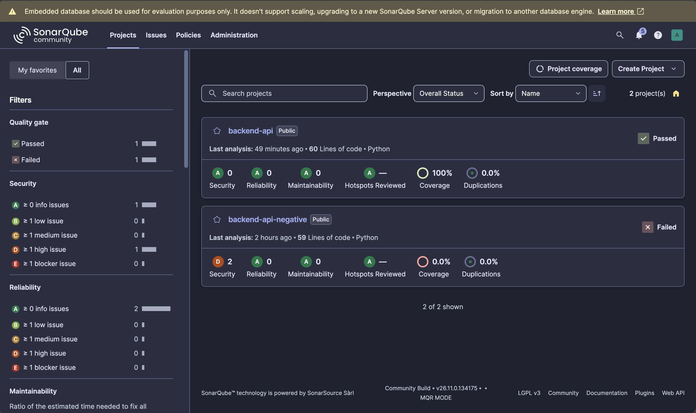

# Scan Results and Execution Evidence

> Redact all sensitive values (account IDs, ARNs, tokens, hostnames) before committing.

## Pipeline run

### GitHub Actions

[First run](https://github.com/irfancen/platform-sandbox/actions/runs/42348532475), triggered by the push of commit `9c23978` on 2026-11-07. It took 3 minutes on GitHub-hosted `ubuntu-24.04` runners.

| Job | Result |
|---|---|
| source-validation | ✅ success |
| terraform-validate | ✅ success |
| secret-scan | ✅ success |
| sca | ✅ success |
| iac-checkov | ✅ success |
| container-scan | ✅ success |
| dast | ✅ success |
| sast | ❌ failure: no SonarQube Cloud project configured |
| deploy | ⏭️ skipped, because a gate failed |

`sast` fails because no SonarQube Cloud organization, project or token is set up for this repository (`You must define the following mandatory properties: sonar.projectKey, sonar.organization`). This is the intended behaviour: SAST fails closed, so a missing scan blocks the release instead of being silently skipped, and `deploy` didn't run. The SAST results below come from a local SonarQube server instead.

### Local runs

Every stage was also run locally on 2026-11-07, with the same tool versions and images as the workflow. For each gate there is a passing run on this repo and a blocked run on a deliberately insecure sample.

| Stage | This repo | Insecure sample |
|---|---|---|
| Source validation | Pass: ruff clean, 12/12 tests, 100% coverage | n/a |
| SAST (SonarQube) | Quality gate PASSED, exit 0 | Quality gate FAILED, exit 3 |
| SCA (Trivy) | 0 vulnerabilities, exit 0 | Critical CVE-2020-14343, exit 1 |
| Secret scanning (Gitleaks) | No leaks, exit 0 | 2 leaks found and redacted, exit 1 |
| IaC (Checkov) | 125 passed, 0 failed, exit 0 | 21 failed, exit 1 |
| Container (Trivy) | All three gates pass, exit 0 | 2 Criticals in the rejected base image, exit 1 |
| DAST (OWASP ZAP) | 0 FAIL, 0 WARN, exit 0 | Reflected and DOM XSS, exit 1 |

`actionlint` 1.7.7 reports no errors on the workflow.

## Source validation

```text
$ ruff check src tests
All checks passed!
$ ruff format --check src tests
3 files already formatted
$ pytest --cov=app --cov-report=term --cov-report=xml:coverage.xml tests
............                                                             [100%]
Name                  Stmts   Miss  Cover
-----------------------------------------
src/app/__init__.py       0      0   100%
src/app/main.py          47      0   100%
-----------------------------------------
TOTAL                    47      0   100%
12 passed
```

## Secret scanning: Gitleaks

Gitleaks 8.30.1. The repo has no commits yet, so the working tree was scanned with `dir`; CI runs `git` mode over the full history.

```text
$ gitleaks dir /repo --redact --verbose --max-target-megabytes 5 --exit-code 1
WRN skipping file: too large max_size=5MB, size=761MB path=/repo/terraform/.terraform/providers/.../terraform-provider-aws_v6.72.0_x5
INF scanned ~67764 bytes (67.76 KB) in 22.2ms
INF no leaks found
exit code: 0
```

The skipped file is the downloaded Terraform provider binary, which is gitignored.

### Blocked: credentials committed to a scratch repo

A fake AWS access key ID and a fake GitHub token were generated at random, committed to a throwaway repository, and scanned with the workflow's exact command:

```text
$ gitleaks git . --redact --verbose --exit-code 1 --report-format sarif --report-path reports/gitleaks.sarif

Finding:     ...WS_ACCESS_KEY_ID = "REDACTED
Secret:      REDACTED
RuleID:      aws-access-token
File:        config.py
Line:        1
Fingerprint: 59d3b5c8ad8c16a570a8746f7c2a63eaa981572b:config.py:aws-access-token:1

Finding:     GITHUB_TOKEN = "REDACTED
Secret:      REDACTED
RuleID:      github-pat
File:        config.py
Line:        2
Fingerprint: 59d3b5c8ad8c16a570a8746f7c2a63eaa981572b:config.py:github-pat:2

INF 1 commits scanned.
WRN leaks found: 2
exit code: 1
```

The SARIF report holds both findings without the secret values.

## SAST: SonarQube

SonarQube Community Build 26.11.0.134175 running locally in Docker, scanned with SonarScanner CLI 8.3.1 (image `sonarsource/sonar-scanner-cli:12.3`), using [sonar-project.properties](../sonar-project.properties).



`backend-api` is this repo: quality gate passed, A ratings, 100% coverage. `backend-api-negative` is the insecure sample: quality gate failed, security rating D, 2 issues. The banner at the top is because this was a throwaway local evaluation instance using SonarQube's embedded database. A real server would use PostgreSQL.

```text
INFO  Sensor Cobertura Sensor for Python coverage [python]
INFO  Parsing report '/usr/src/app/coverage.xml'
INFO  QUALITY GATE STATUS: PASSED
INFO  EXECUTION SUCCESS
exit code: 0

Quality gate: OK
  OK     new_coverage                  LT 80   actual=100.0
  OK     new_duplicated_lines_density  GT 3    actual=0.0
  OK     new_violations                GT 0    actual=0
```

| Measure | Value |
|---|---|
| Lines of code | 60 |
| Bugs / Vulnerabilities / Code smells | 0 / 0 / 0 |
| Security hotspots | 0 |
| Reliability / Security / Maintainability rating | A / A / A |
| Coverage | 100% |
| Duplicated lines | 0% |

### Blocked: insecure code added

A separate project was analysed once as a clean baseline. Then a file was added with MD5 hashing and `requests.get(..., verify=False)`:

```text
ERROR QUALITY GATE STATUS: FAILED
INFO  EXECUTION FAILURE
exit code: 3

Quality gate: ERROR
  OK     new_coverage                  LT 80
  OK     new_duplicated_lines_density  GT 3
  ERROR  new_violations                GT 0   actual=2
Open issues: 2
  python:S4790  SECURITY:HIGH  app/src/app/insecure.py:12  Make sure that hashing data is safe here.
  python:S4830  SECURITY:HIGH  app/src/app/insecure.py:16  Enable server certificate validation on this SSL/TLS connection.
```

## SCA: dependency scanning

Trivy 0.76.2 in `fs` mode on `app/`:

```text
$ trivy fs app --scanners vuln
Report Summary
│ requirements.txt │ pip  │        0        │

Gate: no CRITICAL vulnerabilities                    exit 0
Gate: no HIGH vulnerabilities with a fix available   exit 0
```

### Blocked: vulnerable dependency pinned

```text
$ cat requirements.txt
pyyaml==5.3.1
$ trivy fs . --scanners vuln --severity CRITICAL --exit-code 1
Total: 1 (CRITICAL: 1)
│ pyyaml │ CVE-2020-14343 │ CRITICAL │ fixed │ 5.3.1 │ 5.4 │ PyYAML: incomplete fix for CVE-2020-1747 │
exit code: 1
```

## IaC scanning: Terraform

Run locally on 2026-11-07 with Terraform 1.15.8, AWS provider 6.72.0, TFLint 0.63.1 and Checkov 3.4.3. These are the same commands the `terraform-validate` and `iac-checkov` jobs run.

### Validate and lint

```text
$ terraform -chdir=terraform fmt -check -recursive
$ terraform -chdir=terraform validate
Success! The configuration is valid.

$ tflint --chdir=terraform
(no issues, exit 0)
```

### Checkov: deployable configuration (passes)

```text
$ docker run --rm -v "$PWD:/src" -w /src bridgecrew/checkov:3.4.3 \
    -d terraform --skip-path examples --framework terraform --compact

terraform scan results:

Passed checks: 125, Failed checks: 0, Skipped checks: 3

Check: CKV_AWS_339: "Ensure EKS clusters run on a supported Kubernetes version"
	SKIPPED for resource: aws_eks_cluster.main
	Suppress comment: Ensure EKS clusters run on a supported Kubernetes version. Skipped because EKS supports 1.36 since 2026-06 but the Checkov list stops at 1.35
	File: /main.tf:157-188
Check: CKV2_AWS_11: "Ensure VPC flow logging is enabled in all VPCs"
	SKIPPED for resource: aws_vpc.main
	Suppress comment: Ensure VPC flow logging is enabled in all VPCs. Skipped because flow logs are out of scope for the minimal deployment; listed in README known limitations
	File: /main.tf:36-45
Check: CKV2_AWS_57: "Ensure Secrets Manager secrets should have automatic rotation enabled"
	SKIPPED for resource: aws_secretsmanager_secret.app
	Suppress comment: Ensure Secrets Manager secrets should have automatic rotation enabled. Skipped because the app API key has no rotation Lambda and is rotated manually
	File: /main.tf:239-243

exit code: 0
```

The first scan also failed `CKV_AWS_394`: the `aws_availability_zones` data source didn't pin zone identity. That was fixed in code by pinning the two AZs, not skipped.

### Checkov: insecure fixture (blocked, Scenarios A and B)

```text
$ docker run --rm -v "$PWD:/src" -w /src bridgecrew/checkov:3.4.3 \
    -d terraform/examples/insecure --framework terraform --compact --quiet

terraform scan results:

Passed checks: 16, Failed checks: 21, Skipped checks: 0

exit code: 1
```

| Scenario | Resource | Failed checks |
|---|---|---|
| A: `*:*` policy | `aws_iam_role_policy.deploy` | `CKV_AWS_62` full admin, `CKV_AWS_63` `*` action, `CKV_AWS_355` `*` resource, `CKV_AWS_286` privilege escalation, `CKV_AWS_287` credentials exposure, `CKV_AWS_288` data exfiltration, `CKV_AWS_289` permissions management, `CKV_AWS_290` unconstrained write, `CKV2_AWS_40` full IAM |
| B: public DB | `aws_db_instance.app` | `CKV_AWS_17` publicly accessible, `CKV_AWS_16` unencrypted, `CKV_AWS_161` no IAM auth, `CKV_AWS_293` no deletion protection, `CKV_AWS_129` no logs, plus 6 operational checks |
| B: public DB | `aws_security_group.db` | `CKV_AWS_23` missing description |

## Container scanning: Trivy

Image `backend-api:local` was built from [app/Dockerfile](../app/Dockerfile) on 2026-11-07 and scanned with Trivy 0.76.2, using the same commands as the `container-scan` job.

### Base image selection

| Candidate | Python | Critical | High | Notes |
|---|---|---|---|---|
| `gcr.io/distroless/python3-debian13:nonroot` (chosen) | 3.13.5 | 0 | 35, none with a fix | No shell or package manager; non-root |
| `gcr.io/distroless/python3-debian12:nonroot` | 3.11.2 | 2, none with a fix | 67 | |
| `python:3.13-slim` | 3.13.18 | 0 | 54 | Ships a shell and apt |
| `cgr.dev/chainguard/python:latest` | 3.15.2 | 0 | 0 | Free tier only publishes `latest`; the Python version can't be pinned |

### Image properties

```text
$ docker image ls backend-api:local
backend-api:local 182MB

$ docker inspect --format 'User={{.Config.User}}' backend-api:local
User=65532:65532

$ docker exec backend-api-test sh -c id
exec: "sh": executable file not found in $PATH
```

### Findings

| Target | Critical | High | Medium | Low | With a fix | Secrets |
|---|---|---|---|---|---|---|
| Debian 13.7 OS packages (distroless base) | 0 | 35 | 114 | 54 | 0 | 0 |
| Python packages (21, from `requirements.txt`) | 0 | 0 | 0 | 0 | 0 | 0 |

The 35 High findings are 19 unique CVEs; Debian's Python 3.13 CVEs are counted once for each of four packages. All 19 have Debian status `affected` with no fixed version, so the policy tracks them instead of blocking:

| Package | High CVEs |
|---|---|
| python3.13 (4 packages) | CVE-2026-7210, CVE-2026-15308, CVE-2026-19445, CVE-2026-19553, CVE-2026-82049 |
| libexpat1 | CVE-2026-113351, CVE-2026-115506, CVE-2026-117610, CVE-2026-118370 |
| libuuid1 (util-linux) | CVE-2026-76642, CVE-2026-78408, CVE-2026-78409, CVE-2026-78410 |
| libsqlite3-0 | CVE-2026-119373, CVE-2026-119374, CVE-2026-119379 |
| zlib1g | CVE-2026-76844, CVE-2026-85091. Both are real zlib heap overflows in the `gz*` write API, confirmed via NVD and the Debian tracker; Trivy's title for 76844 is a database error. Fixed only in Debian forky/sid, and not reachable from Python's `zlib`/`gzip` |
| libncursesw6, libtinfo6 | CVE-2025-69720 |

### Policy gates (pass)

```text
Gate: no secrets in image layers                       exit 0
Gate: no CRITICAL vulnerabilities                      exit 0
Gate: no HIGH vulnerabilities with a fix available     exit 0
```

### Policy gate blocking a vulnerable image

The Critical gate run against the rejected debian12 base:

```text
$ trivy image --scanners vuln --severity CRITICAL --exit-code 1 gcr.io/distroless/python3-debian12:nonroot
Total: 2 (CRITICAL: 2)
libsqlite3-0  CVE-2025-7458   CRITICAL  affected      3.40.1-2+deb12u2  sqlite: SQLite integer overflow
zlib1g        CVE-2023-45853  CRITICAL  will_not_fix  1:1.2.13.dfsg-1   zlib: integer overflow and resultant heap-based buffer...

exit code: 1
```

### Runtime checks

The container ran with `--read-only --cap-drop ALL` and a throwaway API key:

```text
PASS  health                   /health              200
PASS  items, no key            /api/v1/items        401
PASS  items, wrong key         /api/v1/items        401
PASS  items, valid key         /api/v1/items        200
PASS  item 2, valid key        /api/v1/items/2      200
PASS  item 99, valid key       /api/v1/items/99     404
PASS  openapi.json disabled    /openapi.json        404
PASS  docs disabled            /docs                404
server header present: False
```

Started with no secret configured, the app refuses to start:

```text
RuntimeError: Set APP_SECRET_ID (Secrets Manager) or APP_API_KEY (local only)
ERROR:    Application startup failed. Exiting.
```

## DAST: OWASP ZAP

ZAP 2.17.0 `zap-api-scan.py`, run with the same steps as the `dast` job:

- the image runs on a Docker network created with `--internal`, with `--read-only --cap-drop ALL`;
- a throwaway API key is sent as `X-API-Key` through `ZAP_AUTH_HEADER` / `ZAP_AUTH_HEADER_VALUE`;
- the rules come from [security/zap-rules.tsv](../security/zap-rules.tsv).

### First scan, before fixes: 2 warnings

```text
WARN-NEW: X-Content-Type-Options Header Missing [10021] x 3
WARN-NEW: Cross-Origin-Resource-Policy Header Missing or Invalid [90004] x 3
FAIL-NEW: 0  WARN-NEW: 2  PASS: 118
```

Both were fixed in the app: every response now sets `X-Content-Type-Options: nosniff`, `Cross-Origin-Resource-Policy: same-origin` and `Cache-Control: no-store`. A unit test covers this.

The app's request log confirms the scan was authenticated: `GET /api/v1/items` returned `200` to ZAP, not `401`.

### After fixes: pass

```text
$ zap-api-scan.py -t http://app:8080/openapi.json -f openapi -c zap-rules.tsv -I -J zap.json -r zap.html
Total of 150 URLs
FAIL-NEW: 0  FAIL-INPROG: 0  WARN-NEW: 0  WARN-INPROG: 0  INFO: 0  IGNORE: 0  PASS: 114
exit code: 0
```

All 32 blocking rules in `zap-rules.tsv` ran, among them SQL injection [40018], XSS [40012], path traversal [6], remote OS command injection [90020], XXE [90023] and Log4Shell [40043].

### Blocked: reflected XSS

A scratch FastAPI app that echoes `?q=` into HTML, scanned with the same rules file:

```text
FAIL-NEW: Cross Site Scripting (Reflected) [40012] x 1
	http://vuln:8080/search?q=%3C%2Fp%3E%3CscrIpt%3Ealert%281%29%3B%3C%2FscRipt%3E%3Cp%3E (200 OK)
FAIL-NEW: Cross Site Scripting (DOM Based) [40026] x 1
	http://vuln:8080/search?q=%3Cscript%3Ealert(5397)%3C/script%3E (200 OK)
FAIL-NEW: 2  WARN-NEW: 6  PASS: 113
exit code: 1
```

Its six missing-header warnings were reported but didn't fail the scan. Only the XSS findings, which are FAIL rules, blocked it.
